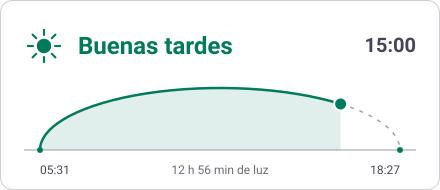

# polite-greetings

A card for your GitHub README that says good morning, good afternoon or good evening at the right time for a place: by the sun, and by the local clock.

<p>
  
  
  
</p>

## Use it

The page at the service's root builds the URL for you, with a preview. By hand:

```html
<picture>
  <source media="(prefers-color-scheme: dark)"
          srcset="https://<host>/api/v2/greeting?tz=America/Sao_Paulo&amp;lat=-15.8&amp;lon=-47.9&amp;layout=sky&amp;theme=dark">
  /api/v2/greeting?tz=America/Sao_Paulo&amp;lat=-15.8&amp;lon=-47.9&amp;layout=sky&amp;theme=light">
</picture>
```

| Parameter | Values | Default |
|---|---|---|
| `tz` | IANA time zone. Sets the local clock. **Required** | |
| `lat`, `lon` | Decimal degrees. Set sunrise and sunset. **Required.** Use your city, not your address | |
| `lang` | `en`, `pt-BR`, `es` | `en` |
| `format` | `svg`, `txt`, `json` | `svg` |
| `layout` | `compact` (one line), `classic` (greeting and facts), `sky` (the sun's path across the day) | `classic` |
| `show` | Comma-separated facts: `sun`, `daylength`, `time`, `tz` | `sun` |
| `theme` | `auto` (follows the viewer's system), `light`, `dark` | `auto` |
| `bg`, `accent`, `text` | Your own colors, six hex digits without `#` | |
| `radius` | Corner radius, 0 to 24 | 24 for `compact`, 12 otherwise |
| `border` | `true`, `false` | `true` |
| `animate` | `true`, `false`. Stops for viewers who ask for reduced motion | `false` |
| `clock` | `24h`, `12h` | `24h` |
| `width` | Display width, 120 to 1200 pixels | the layout's natural width |

The contract, with every response, is [`api/openapi.yaml`](api/openapi.yaml) (OpenAPI 3.1). The service also serves it at `/openapi.yaml`.

## How it decides

- Morning runs from sunrise until 12:00 on the local clock.
- Afternoon runs from 12:00 until sunset.
- Evening runs from sunset until the next sunrise.
- Where the sun does not rise or set that day (polar night, midnight sun), the clock decides: 06:00, 12:00 and 18:00.

## Caching

GitHub loads README images through its image proxy. Responses carry `Cache-Control: no-cache` and a strong `ETag`, so the proxy checks back on each page view and gets a cheap `304 Not Modified` while the card has not changed.

## Privacy

No text from the URL is ever drawn on the card. The access log records the path and the status, not the query string, so the coordinates are not stored.

## Develop

Go 1.27 or later.

```sh
go generate ./...                 # regenerate internal/oapi from api/openapi.yaml
go test ./...                     # rules, every card combination, the HTTP API and the contract
go test ./internal/card -update   # rewrite the golden cards after a deliberate change
go tool staticcheck ./...
PORT=8080 go run ./cmd/server     # then open http://localhost:8080
```

The layout of the code:

| Path | What it holds |
|---|---|
| `api/openapi.yaml` | The contract, source of truth for the HTTP API |
| `internal/oapi` | Code generated from the contract with oapi-codegen. Do not edit it |
| `internal/greeting` | The rules: which greeting, and when it changes. No HTTP, no SVG |
| `internal/card` | The SVG card: one template, three layouts, themes and labels |
| `internal/httpapi` | The handlers, request validation against the contract, `ETag`, problem details |
| `web` | The page that builds a card's URL. Plain HTML, CSS and JavaScript |
| `cmd/server` | Wires it all together |

## Run it

The `Dockerfile` builds a static binary on a distroless image. The service listens on `PORT` (8080 by default) and needs nothing else: no database, no API keys.

## History

v1 (2020–2021) was an Express API that rendered PNGs on Heroku's free tier, which Heroku discontinued in November 2022. v2 is a rewrite. The last v1 commit is tagged `v1-final`.

## License

[Apache-2.0](LICENSE). Versions up to `v1-final` were published under CC BY-NC-ND 4.0.
